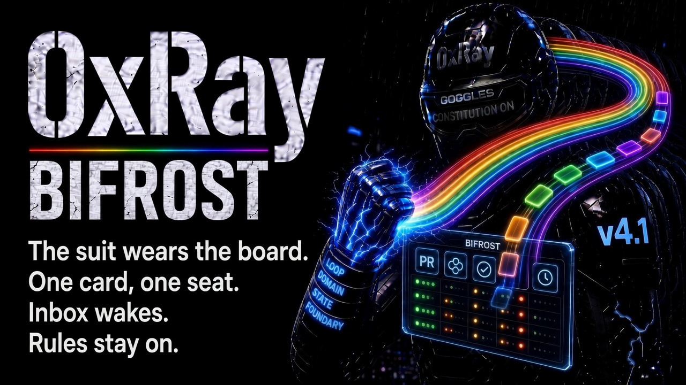

# xray — a suit for coding agents



**4.2** — a suit that survives the context window.

Bifrost is the live board. Goggles views one plane. A search inside that card runs. A search of another plane returns the card. A path outside this checkout runs.

0xRay is a three-subsystem autonomous engine. The suit is the wear. Inference remembers. External Governance judges. The Autonomous Engine runs the work. The host you already run wears it: Grok, OpenCode, Hermes, OpenClaw, or Cursor. Memory, judgement, and payments come on with the suit. When the window closes, the next session wakes with the job, the page, and the laws.

Bifrost turns each pull request, issue, and comment into one card and a line in the right seat's inbox, then wakes that seat. Confer still completes only on a real yes. A foundry is built from mills and hangars. The mill builds and ships. The hangar is the shop.

The product is the **skeleton you wear**.

## Your AI Power Suit

**Your AI Power ⚡️ Suit 🦾** — an exoskeleton that blocks AI slop from becoming real damage.

- **Bone** — three-subsystem engine: Inference · External Governance (Dynamo / Codex) · Autonomous Engine (thinDispatch)
- **Always on** — Codex 11 / 29 / 69, destructive shell, no new MCP/skill/handler surface
- **Temperament** — `frontier` | `guided` | `strict` | `auto` — how loud the engine is, not whether governance exists
- **Wear** — Grok, OpenCode, Hermes, OpenClaw, plus Cursor project hooks. One SSOT gate
- **Muscle** — **Repertoire is preferred.** Vendored 0.2.9 ships **on**. Dest is named laws, not hangar `repo-*` or git slugs. Station is the wake ticket — not a substitute for Repertoire.

Node >= 24.22.3. That is the patched 24 release from 11 Nov 2026. Railway images install that binary from nodejs.org over `node:24.22.1-bookworm-slim`, because Docker Hub has no `node:24.22.3` tag yet. On an older Node, `npm install` prints `EBADENGINE` and still exits 0 when `engine-strict` is off. The warning means the install is outside that runtime. It does not mean Node 22 is supported.

```bash
npm init -y
npm install 0xray
npx 0xray wear
```

A local pack uses the same steps with a file: `npm install ./0xray-<file>.tgz`. Do not extract the tarball by hand. It unpacks into a directory named `package/`. The grok-bot pack unpacks into that same name, so two extracts in one folder collide.

On npm 11, `npm install` may print an allowScripts warning for the `0xray` postinstall. The warning is safe to ignore. The postinstall still runs, and wear links repertoire either way. `npm install-scripts approve 0xray` silences it.

Wear links vendored `@0xray/repertoire` and writes the consumer suit, including when npm did not run the install script. When that script does run, it symlinks vendored `@0xray/repertoire` into `node_modules` and prints `Run npx 0xray wear`. npm may hide that lifecycle line, so the install log can omit it. The script does not write `.mcp.json` or the chat bridges. Wear writes the consumer suit: managed `AGENTS.md`, `.xray` config, seven MCP servers, and the OpenCode, Grok, Hermes, and OpenClaw bridges (`install-bridges.cjs`). Inside a git checkout, wear also fastens Cursor project hooks. The Grok plugin includes `bundle.md`. Session boot reads it. **Repertoire is preferred** — vendored **0.2.9** ships on: factory + stack laws, in-process routing, extra host MCP `repertoire`. Not an eighth `xray-*` server. Dest is a judgment index. Explicit opt-out only: `"enabled": false, "provider": "repertoire"`. Do not pin 0.1.8.

## Quick Start

```bash
npm init -y
npm install 0xray
git init
npx 0xray wear
npx 0xray look dev
npx 0xray status
npx 0xray setup --git-hooks # optional: git hooks only. A folder that is not a git checkout skips them.
npx 0xray inspect --skip-live # mill receipt from the foundry that ships in this package
```

A machine-level `~/.grok/plugins/0xray` that this project did not plant makes `inspect` WARN with the `rm -rf` line to remove it. It fails when Grok would load that plugin (HOME is the machine home) and it points at another root, by a pinned `XRAY_ROOT` or by its launcher paths. Wear never deletes it.

`wear` and `setup` write the project only: `.grok/`, `.hermes/`, `.openclaw/` and `.mcp.json` in the project folder. They do not touch `~/.grok/plugins/0xray`, `~/.hermes` or `~/.openclaw`, which every project on the machine shares, and they print one `machine-bridges: skipped` line. `XRAY_MACHINE_BRIDGES=1` opts in: it retargets the machine Grok plugin and writes the machine Hermes and OpenClaw config for this project. `~/.grok/trusted_folders.toml` is still written so Grok starts the project MCP servers.

`npx 0xray look` opens one card and writes it to `.xray/state/LENS.md`. The planes are `dev`, `integration`, `domain`, and `ecosystem`. A session starts on `dev`. A mill suit's station card says `integration`, which is that plant's plane. `look dev` still opens the dev card. At the end of a turn, write the working notes in `.xray/state/NOTES.md`. The next wake reads `.xray/state/STATION.md`, then the notes, then the lens. Plates: [goggles](docs-site/docs/plates/goggles.md), [notes-page](docs-site/docs/plates/notes-page.md).

A Grok session in this folder does not start the project MCP servers until the folder is trusted. Wear writes `~/.grok/trusted_folders.toml` for this folder and prints `grok-trust: wrote <path>`. Pass `--trust` on that session. `grok --trust` with no terminal exits 1 (`Device not configured`). A headless session also needs `--permission-mode bypassPermissions`. That mode lifts every permission prompt in the session. `--permission-mode dontAsk` stops on `goggles__look` with `permission required`.

Manual per-platform install (idempotent, same bridges wear writes):

```bash
npx 0xray opencode install
npx 0xray grok install # 7 MCPs servers + project .grok/plugins/0xray (not machine last-wins)
npx 0xray hermes install
npx 0xray openclaw install
npx 0xray skill:install # starter skills
```

## Autonomy command (default operating model)

When the suit is worn, **`autonomy-command`** is ON by default: lead dev takes helm, phased todos, best subagent per task, per-suite test triage, loop until green. No keywords required. Slash: `/autonomy-command`

Docs: [guides/autonomy-command](docs-site/docs/guides/autonomy-command.md) · Skill: `src/skills/autonomy-command/SKILL.md`

## What's New Since 3.1

Patch notes are in [CHANGELOG.md](CHANGELOG.md).

## Three-Subsystem Architecture

```
┌─────────────────────────────────────────────────┐
│ Inference │
│ Proposals · Reflection · Memory routing │
├─────────────────────────────────────────────────┤
│ External Governance (Dynamo) │
│ Codex enforcement · Resonance/Isotopic · SSOT │
│ 3 deliberation MCPs: code-review, security, │
│ researcher (within 7-server consumer surface) │
├─────────────────────────────────────────────────┤
│ Autonomous Engine (thinDispatch) │
│ 7-flow · AsideContext · Confidence gate │
└─────────────────────────────────────────────────┘
```

- **Inference** — proposals, reflection, execution planning. Optional memory-routing enrichment (v3.3).
- **External Governance** — Dynamo Solar SSOT; CodexPolicyService; weighted PHI/TAU deliberation.
- **Autonomous Engine** — thinDispatch 7-flow routing; orchestrator confidence gate (v3.3.1).

## Consumer Install (wear)

Wear links the vendored repertoire, including when npm did not run the install script. Wear then:

1. Copies **`AGENTS-consumer.md` → `AGENTS.md`**. Does **not** write consumer-root **`SKILLS.md`**.
2. Fastens **mill plant** (`mill` + `inspect`). Fasten is **foundry-plant/0**: builtin plant is mill+inspect only. `foundry.json` `"plant": "@0xray/blip"` (aliases `"plant": "blip"` / `"plant": "sound"`) fastens whatever that mill package declares — organs (looker, vibe, mixer) live in the mill, not an xray catalog. Inspect is `npx 0xray inspect`, the foundry that ships in this package, not a separate registry download. A mill suit wears the catalog. `foundry.json` `"costume": true` is a separate flag and does not decide that. A blip or sound seat fastens that plant only.
3. Seeds **`.gitignore`** from `.gitignore.default` (if absent)
4. Deploys **`.xray/`** config (`codex.json`, `features.json`, `config.json`) then overlays **their** plant
5. Writes project **`.mcp.json`** with 7 MCPs servers (`npx -y 0xray mcp …`)
6. Installs **4 chat bridges**: OpenCode, Grok, Hermes, OpenClaw, plus **Cursor** `.cursor/hooks.json` (PPE + wiring; mill plant, not costume)
7. Factory shop plant (`shop-extract`, `shop-witness`, `shop-pin` from groover-hangar) may coexist when worn. Extra shops: `foundry.json` `shopPlant`. Not costume.
8. Fastens Cursor `.cursor/hooks.json`, `.cursor/mcp.json`, and the hook scripts even when the folder is not a git checkout, and keeps an unwear snapshot. A git checkout prints `cursor-wear: wrote .cursor/hooks.json and .cursor/mcp.json`. `git init` before wear is what lets `npx 0xray setup --git-hooks` install git hooks. Outside a git checkout, that command says the git hooks were skipped.

See [llms.txt](llms.txt) for the agent map. The catalog in [SKILLS.md](SKILLS.md) is what a mill suit wears, plus the `mill` and `inspect` plant skills. `npx 0xray status` counts those worn skills. `Agents: N configured` is the seven built-in names, or the names in `.xray/agents.json` when that file lists them. The `.opencode/agents/*.yml` files are the OpenCode role catalog, not that count. `repertoire__get_task_confidence` requires `description`.

## Seven MCP Servers (consumer)

All registered via `npx -y 0xray mcp <cmd>` — no brittle `dist/` paths:

| Server | Command | Role |
|--------|---------|------|
| `xray-governance` | `mcp governance` | Proposal governance, codex snapshot, quality gates |
| `xray-skills` | `mcp skills` | 45 knowledge skills + skill invocation |
| `xray-orchestrator` | `mcp orchestrator` | Complexity analysis, lead-dev plan, task delegation |
| `xray-enforcer` | `mcp enforcer` | Codex compliance, rule validation |
| `xray-researcher` | `mcp researcher` | Codebase exploration, implementation lookup |
| `xray-code-review` | `mcp code-review` | Proposal quality, best practices |
| `xray-architect-tools` | `mcp architect-tools` | System design, architecture decisions |

The framework repo also ships additional internal `.server.ts` implementations for orchestration pipelines — these are not part of the 7-server consumer `.mcp.json` surface.

## Agents

**42 YML agent surfaces** in `src/opencode/agents/*.yml` — zero manual registration. Invoke via `@agent-name` in OpenCode.

Core governance agents:

| Agent | Purpose |
|-------|---------|
| `@enforcer` | Codex compliance & error prevention |
| `@orchestrator` | Multi-step task coordination |
| `@architect` | System design & technical decisions |
| `@security-auditor` | Vulnerability detection |
| `@code-reviewer` | Quality assessment |
| `@refactorer` | Technical debt elimination |
| `@testing-lead` | Testing strategy |
| `@bug-triage-specialist` | Error investigation |
| `@researcher` | Codebase exploration |

See [AGENTS.md](AGENTS.md) and [SKILLS.md](SKILLS.md) for the full agent and skill catalog.

## Memory Routing + Repertoire (preferred, v3.3+)

**Wear Repertoire.** It is the long-term judgment organ. Station holds the ticket across compact. Dest is named invariants, not keywords. Pluggable `memory_routing` in `features.json` (validated by `features.schema.json`) ships **on**:

```json
"memory_routing": {
 "enabled": true,
 "provider": "repertoire",
 "module_path": "node_modules/@0xray/repertoire/dist/provider/memory-routing-provider.js",
 "config": {
 "signalsPath": ".xray/state/repertoire/curated_signals.json",
 "statePath": ".xray/state/repertoire/inference-state.json",
 "feedbackDir": ".xray/state/repertoire/feedback"
 }
}
```

| Integration | What it does |
|-------------|--------------|
| **ExecutionPlanner** (v3.3.1) | `getTaskConfidence()` → complexity boost, trap hints, signal-aware `selectAgent()` |
| **thinDispatch** | Nucleus `scoreAndRoute()` (`0xray/nucleus`); memory provider `resolveThinDispatch()` when routing enabled |
| **Researcher** | `researcher-confidence.ts` appends `MEMORY_ROUTING:` block to governance output |
| **AsideContext** (v3.2) | `buildInheritedContext` → `inheritedContext.memoryRouting` on orchestrator `spawnAside` |
| **Feedback** | Per-task `ingestFeedback()` closes the learning loop |

**External hosts** (Hermes/Grok): add `repertoire-mcp` to `.mcp.json` — see Repertoire docs. Preferred. Not optional flavor.

Explicit opt-out only: `"memory_routing": { "enabled": false, "provider": "repertoire" }`.

Docs: [memory routing](docs-site/docs/guides/memory-routing.md) · [Repertoire](docs-site/docs/guides/repertoire.md) · [features.json](docs-site/docs/guides/features-json.md) · [all features since 3.1](docs-site/docs/guides/features-since-3.1.md)

## Integrations

| Platform | Install | What that command writes |
|----------|---------|----------------------|
| **OpenCode** | `npx 0xray opencode install` | Merges `opencode.json`, copies agent YML surfaces |
| **Grok CLI / Build** | `npx 0xray grok install` | Project `.grok/plugins/0xray` (shared HOME does not clobber machine plugin), 7 MCPs servers |
| **Hermes Agent** | `npx 0xray hermes install` | Project `.hermes/plugins/xray-hermes` when the folder is under a temp directory or HOME is not the machine home. Otherwise `~/.hermes/plugins/xray-hermes`. |
| **OpenClaw** | `npx 0xray openclaw install` | `.xray/config/openclaw.json`, skill sync |
| **Cursor** | `npx 0xray wear` inside a git checkout | Fastens `.cursor/hooks.json` + relative `.cursor/hooks/*.sh`. Rewrites leftover env-assignment one-liners. Not a fifth chat TUI. |

## Governance & Codex

- **70 terms** in `.xray/codex.json` — core, architecture, testing, performance, security, operations, governance (Codex 69: no new MCP/skill/handler surface; Codex 70: current copy before edits)
- CodexPolicyService — Governance-owned SSOT for codex loading
- Pre-governance gate blocks non-compliant proposals
- Active codex snapshot via `get_active_codex` MCP tool
- frameworkLogger structured logging (never `console.*`)

## Testing

| Suite | Status |
|-------|--------|
| Four-floor consumer e2e | OpenCode 34/0 · Grok 63/0 · Hermes 39/0/2 · OpenClaw 96/0/1 |
| Consumer smoke | `npm run release:gate` — pack → clean install → 7 MCPs + 4 chat bridges + Cursor hooks + organ on |
| Pack → tmp proof | `npm run pack:tmp-proof` — tgz install + `foundry mint --skip-live` + hangar shops + inspect (no costume dump). Playwright n/a (CLI). |

```bash
npm test
npm run pack:tmp-proof # pack → tmp fasten + hangar inspect
npm run release:gate # full release gate (before upload)
npm run release:npm # gate + prepare + npm publish --access public
```

## Release

The **4.1** line is on npm. Do **not** run `release:major` to ship a 4.x fix (that becomes 5.0.0). Do **not** put a `scripts.publish` lifecycle that re-runs the gate after the registry PUT. Patch number lives in `package.json` + CHANGELOG.

```bash
npm run release:gate
npm run release:npm # after gate is green; uses npm publish --access public
npm run release:patch # version bump pipeline (not for an already-bumped package.json)
```

Pipeline: reconcile-version → release-gate (build + test + consumer smoke) → CHANGELOG/README/AGENTS artifacts → commit → tag → npm publish.

## License

MIT — see [LICENSE](LICENSE)

---

*xray — a three-subsystem autonomous engine. The suit is the wear.*